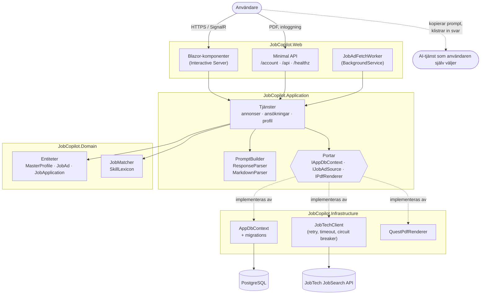
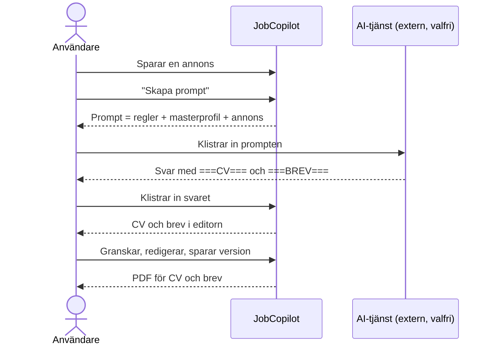

# JobCopilot

[](https://github.com/ZRiveros/JobCopilot/actions/workflows/ci.yml)

Ett självhostat verktyg som hjälper en utvecklare att hitta och söka jobb: det hämtar annonser
från Platsbanken, rankar dem mot din profil, visar vad du saknar, och hjälper dig ta fram ett
skräddarsytt CV och personligt brev – utan att någonsin hitta på erfarenhet åt dig.

Byggt med .NET 10, Blazor (Interactive Server), EF Core och PostgreSQL. En användare, en
container plus databas, inga externa tjänster utöver det öppna annons-API:et.

## Innehåll

- [Funktioner](#funktioner)
- [Skärmdumpar](#skärmdumpar)
- [Arkitektur](#arkitektur)
- [Kom igång lokalt](#kom-igång-lokalt)
- [Produktion med Docker Compose](#produktion-med-docker-compose)
- [Konfiguration](#konfiguration)
- [Tester](#tester)
- [Designbeslut](#designbeslut)
- [API](#api)
- [Vad återstår](#vad-återstår)

## Funktioner

| | |
|---|---|
| **Masterprofil** | All erfarenhet, projekt, skills, utbildning, språk och styrkor på ett ställe. Enda sanningskällan för allt som genereras. |
| **Annonsflöde** | En bakgrundstjänst hämtar annonser från [JobTech JobSearch API](https://jobsearch.api.jobtechdev.se/) med jämna mellanrum. Sökningarna (sökord, kommuner, distans) redigeras i UI:t. Samma annons sparas bara en gång, och ett API-fel på en sökning stoppar inte de andra. |
| **Matchning** | Varje annons får 0–100 poäng mot profilen. Du ser vilka skills som matchar, vilka som saknas och varför poängen blev som den blev. |
| **Kompetensgap** | En samlad vy över de skills som oftast saknas över alla aktuella annonser – ett svar på ”vad ska jag lära mig härnäst?”. |
| **Dashboard** | Rankad lista med sök, filter och sortering. Annonser kan sparas eller döljas, och du kan lägga till annonser du hittat på annat håll. |
| **Ansökan via kopiera-prompt** | Appen bygger en färdig prompt av profil + annons + regler. Du klistrar in den i valfri AI-tjänst, klistrar tillbaka svaret, redigerar, och exporterar CV och brev som PDF. Varje sparning blir en ny version. |
| **Ansökningstavla** | Kanban: Sparad → Skickad → Intervju → Erbjudande/Avslag, med datum, anteckningar, kontaktperson och påminnelse om uppföljning. Drag-and-drop, med en lista på varje kort som alternativ för pekskärm och tangentbord. |
| **Inloggning** | Ett lösenord från `.env`, cookie-baserad inloggning, allt utom inloggningssidan kräver inloggning. |

## Skärmdumpar

> Skärmdumparna är inte tillagda ännu. Filnamn och motiv finns beskrivna i
> [`docs/screenshots/README.md`](docs/screenshots/README.md).

| Annonser | Varför matchar annonsen? |
|---|---|
|  |  |

| Kompetensgap | Ansökningstavla |
|---|---|
|  |  |

| Ansökan: prompt, svar och editor | Exporterat CV |
|---|---|
|  |  |

## Arkitektur

Fyra projekt med beroenden som pekar inåt: `Web → Infrastructure → Application → Domain`.



| Projekt | Ansvar |
|---|---|
| `JobCopilot.Domain` | Entiteter och rena regler: matchning, kanban-övergångar. Ingen I/O, inga beroenden. |
| `JobCopilot.Application` | Användningsfall som tunna tjänster, portarna mot omvärlden, promptbyggaren, svarstolken och den Markdown-delmängd som CV:t skrivs i. |
| `JobCopilot.Infrastructure` | EF Core-kontext och migrations, HTTP-klienten mot JobTech, PDF-rendering med QuestPDF. |
| `JobCopilot.Web` | Blazor-UI, minimal API, cookie-inloggning och den hostade bakgrundstjänsten. |

### Så går en ansökan till



JobCopilot pratar aldrig själv med en AI-tjänst. Människan står i mitten av varje steg.

## Kom igång lokalt

Krav: [.NET 10 SDK](https://dotnet.microsoft.com/download) och en PostgreSQL-server (14 eller senare).

```bash
# 1. En databas. Med Docker:
docker run -d --name jobcopilot-db -p 5432:5432 \
  -e POSTGRES_USER=jobcopilot -e POSTGRES_PASSWORD=jobcopilot -e POSTGRES_DB=jobcopilot \
  postgres:17-alpine

# 2. Ett inloggningslösenord (minst 8 tecken), sparat utanför repot
dotnet user-secrets set "Auth:Password" "välj-ett-lösenord" --project src/JobCopilot.Web

# 3. Starta
dotnet run --project src/JobCopilot.Web
```

Öppna <http://localhost:5139>. Databasen migreras automatiskt vid start, och fyra
exempelsökningar läggs till första gången. Börja med att fylla i **Profil** – utan skills i
profilen får alla annonser 0 poäng.

Utvecklingsmiljön förväntar sig databasen ovan (`appsettings.Development.json`). Använder du en
annan server:

```bash
dotnet user-secrets set "ConnectionStrings:Default" "Host=...;Database=...;Username=...;Password=..." --project src/JobCopilot.Web
```

## Produktion med Docker Compose

Krav: Docker med Compose 2.20 eller senare.

```bash
git clone https://github.com/ZRiveros/JobCopilot.git
cd JobCopilot
cp .env.example .env        # sätt JOBCOPILOT_PASSWORD och POSTGRES_PASSWORD
docker compose up -d --build
```

Appen svarar på port 8080 (ändras med `JOBCOPILOT_PORT`). Det som startar är två containrar:

| Tjänst | Image | Minnesgräns | Kommentar |
|---|---|---|---|
| `web` | byggs från `Dockerfile` | 384 MB | Workstation-GC och `GCConserveMemory`, kör som icke-root utan capabilities |
| `postgres` | `postgres:17-alpine` | 192 MB | `shared_buffers=32MB`, `max_connections=20`, ingen publicerad port |

### Använda en befintlig PostgreSQL

Kör du redan en PostgreSQL-server behöver du ingen till. I `.env`:

```ini
COMPOSE_PROFILES=
JOBCOPILOT_DB_CONNECTION=Host=host.docker.internal;Port=5432;Database=jobcopilot;Username=jobcopilot;Password=hemligt;Maximum Pool Size=10
```

Då startar bara `web`. Databasen och användaren måste finnas; tabellerna skapas vid start.
`host.docker.internal` pekar på Docker-värden. Ligger databasen i ett annat compose-projekt,
anslut `web` till det nätverket och använd tjänstens namn som `Host`.

### Bakom en reverse proxy

Appen gör ingen egen TLS. Sätt `BEHIND_PROXY=true` när Caddy, nginx eller Traefik terminerar
HTTPS framför den, så att appen litar på `X-Forwarded-Proto`. Proxyn måste släppa igenom
WebSockets – Blazor Server använder en SignalR-anslutning.

### Drift

```bash
docker compose logs -f web                    # loggar
git pull && docker compose up -d --build     # uppdatera; migrations körs vid start
docker compose exec postgres pg_dump -U jobcopilot jobcopilot > backup.sql   # säkerhetskopia
```

`GET /healthz` svarar 200 när appen når databasen och kräver ingen inloggning.

## Konfiguration

| `.env` (compose) | Appinställning | Standard | Beskrivning |
|---|---|---|---|
| `JOBCOPILOT_PASSWORD` | `Auth:Password` | – (krävs) | Inloggningslösenord, minst 8 tecken. Appen vägrar starta utan. |
| `POSTGRES_PASSWORD` | – | – | Lösenord för den medföljande databasen. |
| `COMPOSE_PROFILES` | – | `bundled-db` | Töm för att inte starta den medföljande databasen. |
| `JOBCOPILOT_DB_CONNECTION` | `ConnectionStrings:Default` | medföljande databas | Anslutningssträng till en befintlig PostgreSQL. |
| `JOBCOPILOT_PORT` | – | `8080` | Port på värden. |
| `FETCH_INTERVAL_MINUTES` | `Fetch:IntervalMinutes` | `60` | Minuter mellan hämtningar (5–1440). |
| `BEHIND_PROXY` | `ASPNETCORE_FORWARDEDHEADERS_ENABLED` | `false` | Lita på proxyns forwarded-headers. |
| – | `Fetch:Enabled` | `true` | Stänger av bakgrundshämtningen. |
| – | `JobTech:MaxAdsPerSearch` | `300` | Tak per sökning och hämtning, nyast först. |
| – | `Auth:SessionDays` | `14` | Hur länge en inloggning gäller utan aktivitet. |

Appinställningar sätts som miljövariabler med dubbla understreck, t.ex. `JobTech__MaxAdsPerSearch=500`.

## Tester

```bash
dotnet test
```

| Projekt | Vad som testas | Kräver |
|---|---|---|
| `JobCopilot.Domain.Tests` | Termsökning (`C#`, `.NET`, `Java` ≠ `JavaScript`), lexikon, poängsättning, kanban-regler | – |
| `JobCopilot.Application.Tests` | Promptens hårda regler, svarstolken, Markdown-delmängden, dokumentkomposition, kompetensgap | – |
| `JobCopilot.Web.Tests` | Komponenter med bUnit: annonskort, kanban med drag-and-drop, prompt-kopiering, inklistring av svar | – |
| `JobCopilot.Infrastructure.Tests` | JobTech-klienten mot en stubbad HTTP-hanterare, PDF-rendering, att migrations är i synk med modellen | – |
| `JobCopilot.Infrastructure.Tests` (`Database/`) | Tjänsterna och hela webbappen mot riktig PostgreSQL: profil, hämtning med deduplicering, filter, tavlan, inloggning, API, PDF-nedladdning | PostgreSQL |

Databastesterna startar PostgreSQL med [Testcontainers](https://dotnet.testcontainers.org/) och
behöver därför Docker. Utan Docker kan de köras mot en befintlig server:

```bash
JOBCOPILOT_TEST_POSTGRES="Host=localhost;Username=postgres;Password=..." dotnet test
```

Varje test skapar och tar bort sin egen databas. Finns varken Docker eller variabeln hoppas
testerna över med en tydlig anledning – i CI är `JOBCOPILOT_REQUIRE_DB_TESTS=true` satt så att
de aldrig kan hoppas över obemärkt.

CI (GitHub Actions) bygger med varningar som fel, kör alla tester, bygger Docker-imagen och
startar hela compose-stacken för att kontrollera att appen blir frisk och att inloggningen skyddar API:et.

## Designbeslut

### Varför AI-steget är human-in-the-loop

Appen innehåller ingen AI-integration, ingen API-nyckel och inget utgående anrop utöver
JobTech. Den bygger en prompt, och tar emot ett svar som du själv klistrar in.

- **Du väljer modell och betalar inget extra.** Prompten fungerar i vilken chattjänst som helst,
  även en lokal modell.
- **Ingenting skickas utan att du ser det.** Prompten visas i klartext innan du kopierar den.
  Kontaktuppgifter (e-post, telefon, länkar) utelämnas ur prompten och läggs till först i PDF:en.
- **Du granskar alltid resultatet.** En ansökan är ett dokument du skriver under med ditt namn.
  Svaret hamnar i en editor, inte direkt i en PDF, och det går inte att exportera utan att spara
  en version du har haft framför dig.
- **Mindre att drifta.** Inga hemligheter att rotera, inga kostnader som kan skena, inget
  beroende som kan sluta fungera.

### Varför genereringen är låst till masterprofilen

Språkmodeller fyller gärna i luckor. Ber man en modell att ”anpassa CV:t efter annonsen” lägger
den lätt till den där tekniken annonsen frågar efter. Ett CV med påhittad erfarenhet är värre än
inget CV, så låsningen sitter på flera ställen:

1. **Prompten** säger att masterprofilen är den enda sanningskällan: modellen får välja ut,
   prioritera och formulera om – aldrig lägga till arbetsgivare, tekniker, siffror eller år.
2. **Matchningen följer med.** Skills som annonsen efterfrågar men profilen saknar listas
   uttryckligen som ”får INTE påstås”.
3. **Annonsen är data, inte instruktioner.** Annonstexten kommer utifrån och skulle kunna
   innehålla text som försöker styra modellen. Den stängs in i ett markerat block, prompten säger
   att instruktioner i blocket ska ignoreras, och markörer i annonstexten neutraliseras.
4. **Kontaktuppgifterna i PDF:en kommer från profilen**, aldrig från det inklistrade svaret.
5. **Reglerna är testade.** Enhetstester kontrollerar att reglerna, kravet på svenska och
   markörerna finns i prompten, och att en fientlig annons inte kan bryta sig ur sitt block.

Det här gör det svårare för modellen att hitta på – det gör det inte omöjligt. Därför är
granskningssteget inte valfritt, och editorn påminner om det.

### Fast svarsformat med markörer

Prompten begär svaret mellan `===CV===`, `===BREV===` och `===SLUT===`. Tolken är förlåtande mot
det chattmodeller brukar lägga till (inledande artighetsfras, kodblock, fetstil runt markören,
saknad slutmarkör) men säger tydligt vad som är fel när något saknas. Ett test matar in promptens
eget formatexempel i tolken, så att de två aldrig kan glida isär.

CV:t skrivs i en liten Markdown-delmängd (`##`, `###`, punktlistor, fetstil). Den räcker för ett
CV, går att redigera för hand, och varken förhandsvisningen eller PDF:en behöver tolka HTML.

### Förklarbar matchning i stället för ”smart” matchning

Poängen är andelen av annonsens efterfrågade skills som finns i profilen, viktat efter var de
nämns (rubrik 3, arbetsgivarens angivna krav 2, löptext 1), med ett golv så att en annons som
bara nämner en känd skill inte kan få 100 %. En junior-signal ger +10, en senior-signal i
rubriken −15. Det är enkelt nog att förklara i UI:t – och det är poängen: en siffra man inte
förstår litar man inte på.

Att hitta `C#` och `.NET` i löptext kräver egen termsökning, eftersom vanliga ordgränser i
reguljära uttryck inte fungerar för namn som börjar eller slutar med skiljetecken. Sökningen
ser också till att `Java` inte matchar `JavaScript`, att `Azure DevOps` inte också räknas som
`Azure`, och att `REST` inte matchar ”the rest of the team”.

### Blazor Server och DbContext

En scoped `DbContext` lever i Blazor Server lika länge som webbläsarfliken, vilket ger inaktuell
data och samtidighetsfel. Tjänsterna tar därför en `IAppDbContextFactory` och skapar en
kortlivad kontext per operation. Komponenterna anropar tjänsterna direkt i stället för att gå
via appens eget HTTP-API – ett extra nätverkshopp till samma process ger ingenting.

### Profilen som JSON, annonserna som tabeller

Masterprofilen läses och skrivs alltid som en helhet, så dess avsnitt lagras som `jsonb` på en
rad i stället för fem undertabeller. Annonser och ansökningar filtreras, sorteras och
relateras – de är vanliga tabeller, med skills som `text[]` så att ”annonser som nämner Docker”
blir en enkel fråga.

### Säkerhet för en enanvändarapp

- Allt kräver inloggning genom en fallback-policy: en ny sida eller endpoint är skyddad utan
  att någon behöver komma ihåg det.
- Lösenordet jämförs i konstant tid, inloggningen är hastighetsbegränsad, och appen vägrar
  starta med ett saknat eller för kort lösenord.
- Inloggningsformuläret har antiforgery-token, och auth-kakan är `HttpOnly` och `SameSite=Lax`.
- Nycklarna som signerar kakan lagras i databasen, så inloggningen överlever en omstart utan
  att web-containern behöver en egen volym.
- Annonstext renderas alltid som ren text.

### Lättviktig drift

En process gör allt: UI, API och schemalagd hämtning. Ingen kö, ingen cache, ingen separat
worker-container. Hämtningen går sekventiellt mot JobTech med standardiserad resilience
(återförsök med backoff, timeout, circuit breaker) och ett tak per sökning.

## API

Utöver UI:t finns ett litet JSON-API för den som vill skripta mot sin egen data. Alla
endpoints kräver inloggningskakan och svarar `401` utan den.

| Metod | Sökväg | Beskrivning |
|---|---|---|
| `GET` | `/api/ads` | Rankade annonser. Parametrar: `search`, `minScore`, `view`, `sort`, `municipality`, `skill`, `includeExpired`, `skip`, `take`. |
| `GET` | `/api/ads/{id}` | En annons med matchning. |
| `GET` | `/api/skill-gaps` | Saknade och matchade skills över alla aktuella annonser. |
| `GET` | `/api/applications` | Korten på ansökningstavlan. |
| `GET` | `/api/applications/versions/{id}/cv.pdf` | CV för en sparad version. |
| `GET` | `/api/applications/versions/{id}/letter.pdf` | Personligt brev för en sparad version. |
| `POST` | `/api/fetch` | Begär en hämtning nu. |
| `GET` | `/healthz` | Hälsokontroll (öppen). |

## Vad återstår

Kända luckor och idéer, ungefär i prioritetsordning:

- **Skärmdumpar** till README:n.
- **Redigerbar skill-katalog.** Katalogen med kända skills ligger i kod (`SkillCatalog`). Egna
  skills från profilen känns igen, men synonymer och nya ”saknade” skills kräver en kodändring.
- **Påminnelser utanför appen.** Uppföljningar syns på startsidan och tavlan, men inget skickas
  som e-post eller notis.
- **Städning av gamla annonser.** Utgångna annonser döljs i listan men ligger kvar i databasen.
- **Fler källor.** `IJobAdSource` är en port; i dag finns bara JobTech plus manuellt tillagda annonser.
- **Vilken sökning hittade annonsen?** Sparas inte, så det går inte att filtrera på sökning.
- **Historik på tavlan.** Bara senaste statusbytet och datumen sparas, inte hela förloppet.
- **Bättre matchning.** Böjda och sammansatta svenska ord (”Azuremiljö”) missas, och allt som nämns
  i en annons väger lika oavsett om det står under ”krav” eller ”meriterande”.
- **Jämföra versioner** av en ansökan sida vid sida.
- **Engelska ansökningar.** Prompten kräver svenska; ett språkval per ansökan vore naturligt.
- **Licens.** Repot har ingen licensfil ännu. Notera att QuestPDF används under sin
  Community-licens, som gäller för privatpersoner och mindre verksamheter.

## Tack till

- [JobTech Development](https://jobtechdev.se/) (Arbetsförmedlingen) för det öppna annons-API:et.
- [QuestPDF](https://www.questpdf.com/) för PDF-genereringen.
